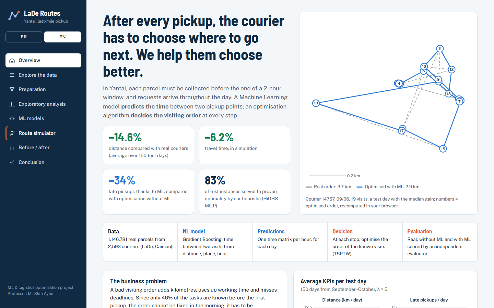
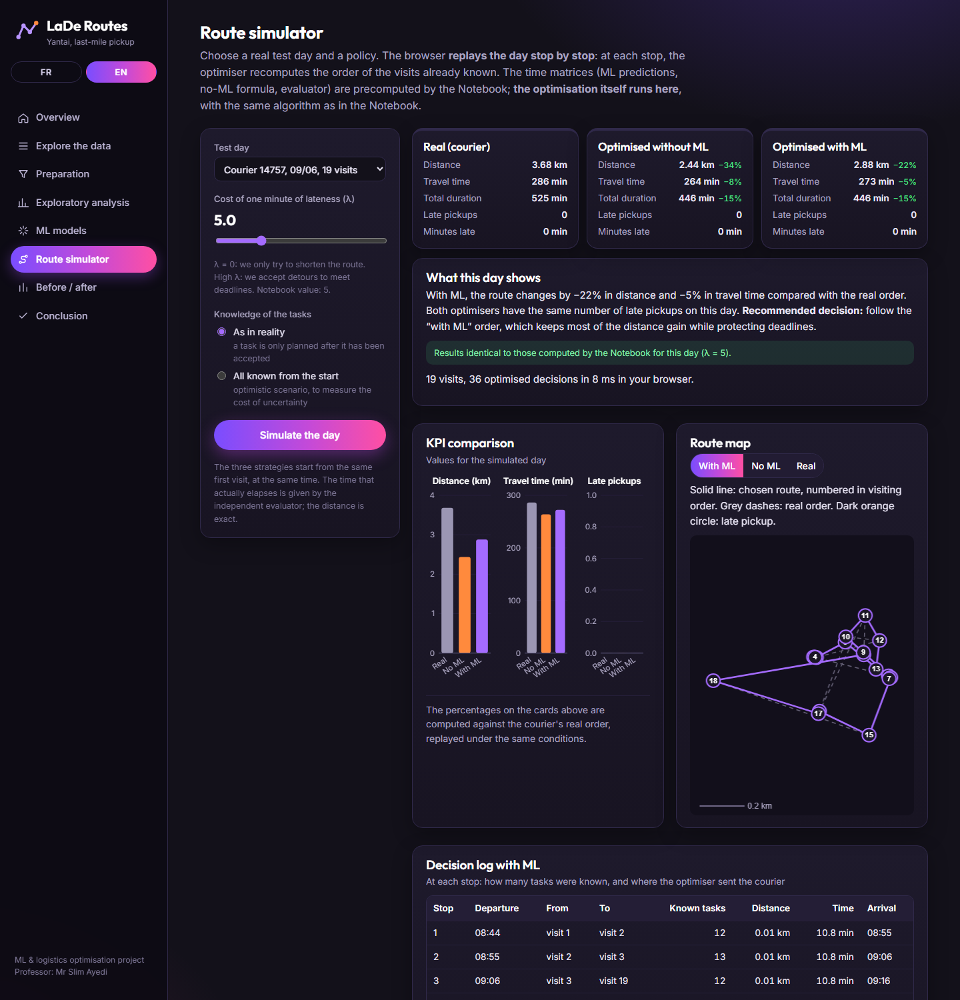
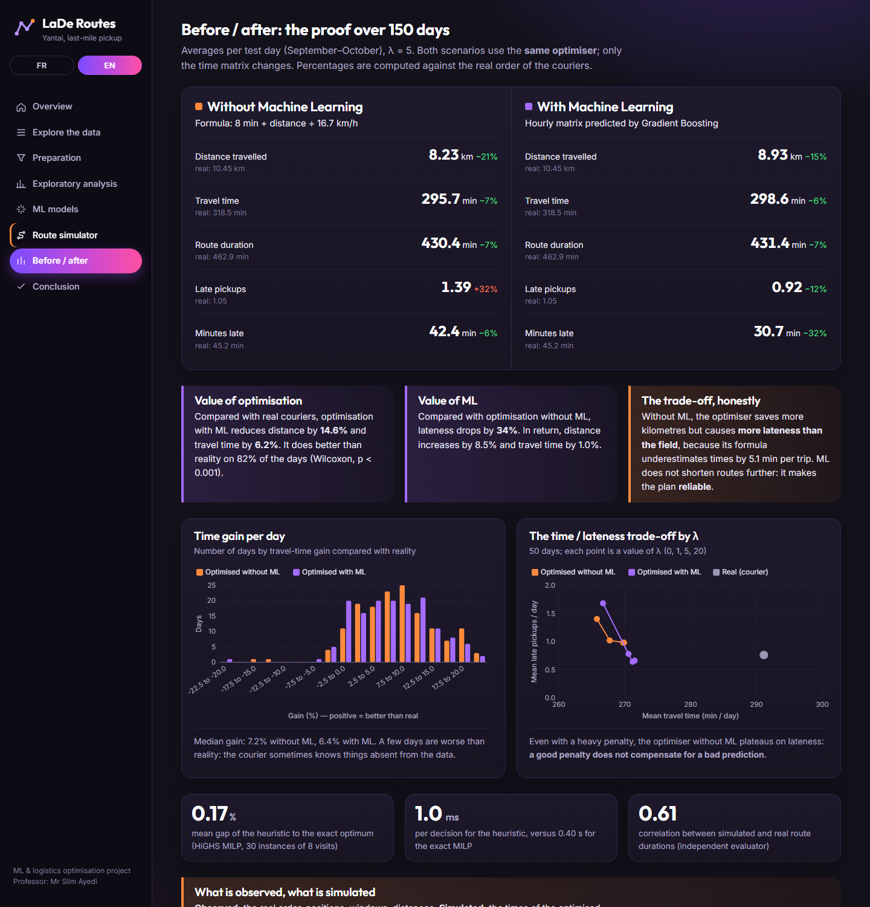
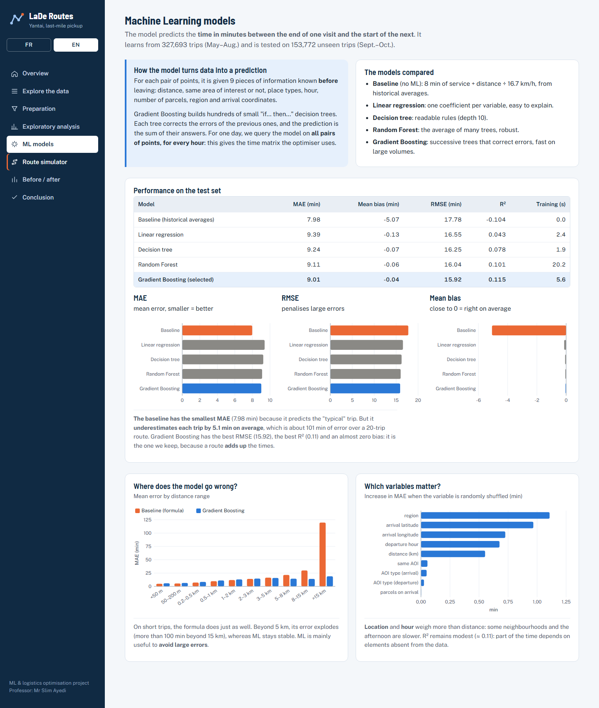
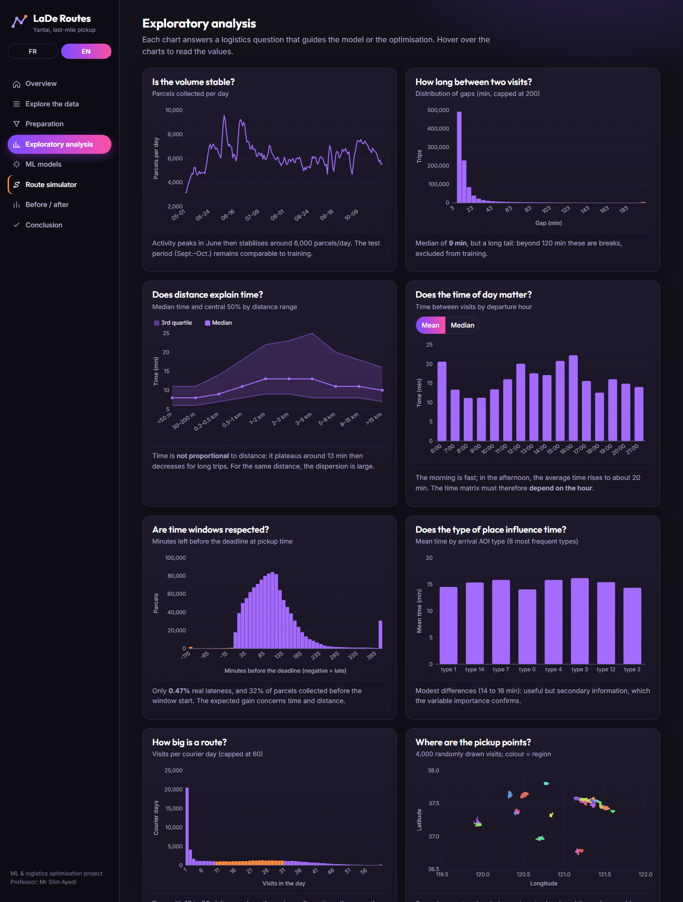
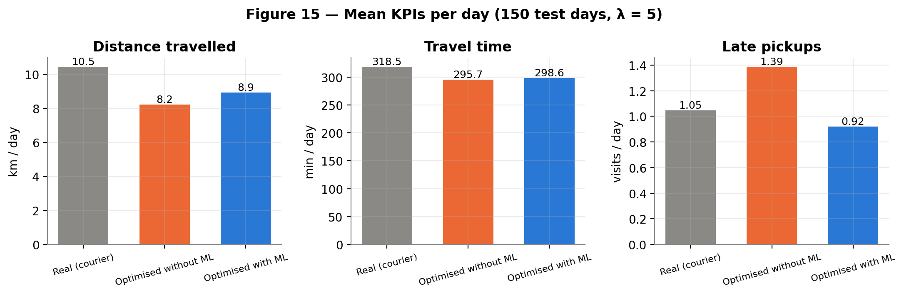
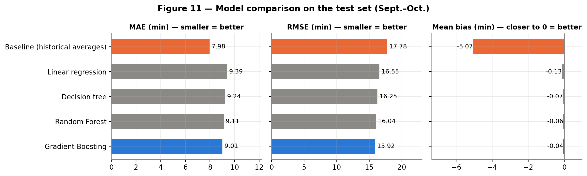
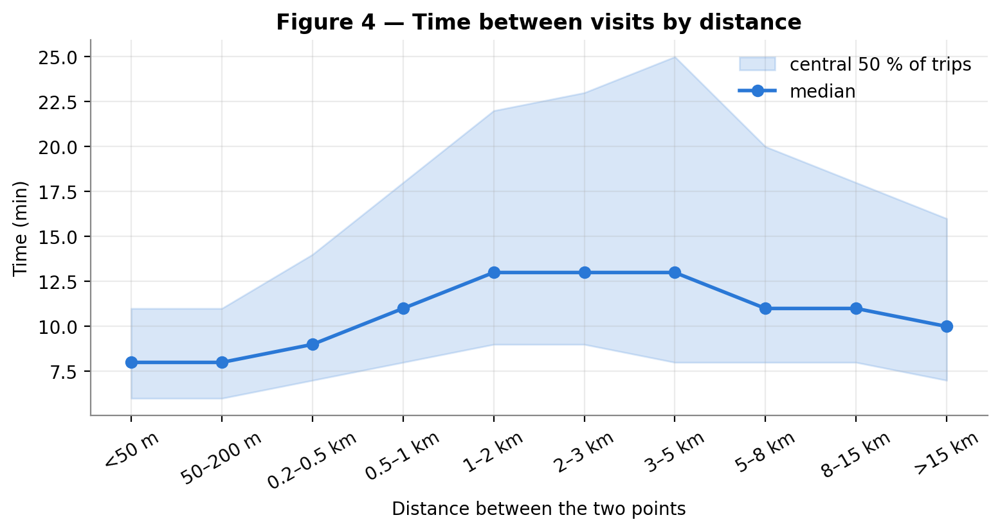

# Courier routes with time windows, augmented by Machine Learning

*[Version française : README.fr.md](README.fr.md)*

Machine Learning and logistics optimisation project (Master AIDA, Dauphine-PSL). Professor: Mr Slim Ayedi.
Dataset: **LaDe-P** (Cainiao, Apache-2.0 licence), city of **Yantai**, 1,146,781 parcels.

**The idea in one sentence:** Machine Learning predicts the time between two pickup points; an optimisation algorithm (TSP with time windows, solved at every stop) uses these predictions to choose the visiting order.

The project is available in **English and French**: notebook, report and web platform.

## Preview

### Web platform

Interactive platform (English / French): overview, data explorer, preprocessing, EDA, ML models, a **route simulator that runs the optimisation in the browser**, and a before/after comparison.





<details>
<summary>More screenshots</summary>







</details>

### Key figures

**Main result: optimisation shortens routes, and ML keeps the plan reliable (fewer late pickups than optimisation without ML).**



**Why ML: the baseline formula underestimates travel times (strongly negative bias), while the ML models are unbiased.**



**Travel time is not proportional to distance, which a "distance ÷ speed" formula cannot capture.**



## Structure

```
Projet_Tournees_LaDe/
├── notebook/
│   ├── projet_tournees_lade_en.ipynb      ← English notebook (run it to produce the English outputs)
│   └── projet_tournees_lade_fr.ipynb      ← French notebook, already executed (outputs included)
├── data/
│   ├── pickup_yt.csv                      ← to download (not included, 190 MB, see below)
│   └── donnees_preparees_echantillon.csv  ← 50,000 prepared pairs (features + target)
├── exports/                               ← results of the French notebook (JSON / CSV)
├── exports_en/                            ← written by the English notebook
├── rapport/
│   ├── rapport_final_en.pdf / .docx       ← English report (7 pages, A4)
│   ├── rapport_final_fr.pdf / .docx       ← French report (7 pages, A4)
│   ├── figures/                           ← 18 PNG figures (French notebook)
│   └── figures_en/                        ← 18 PNG figures (English notebook)
├── web/
│   ├── index_en.html, app_en.js           ← English platform
│   ├── index.html, app.js                 ← French platform
│   ├── style.css, simulateur.js           ← shared
│   ├── lib/graphiques.js                  ← SVG chart engine (no dependency)
│   ├── data/donnees.js                    ← data of the French platform (+ JSON/CSV)
│   └── data_en/donnees.js                 ← data of the English platform
├── presentation/
│   └── guide_presentation.md              ← summary, oral script, Q&A, code walkthrough, demo guide (French)
├── requirements.txt
└── README.md
```

## 1. Get the dataset

1. Open https://huggingface.co/datasets/Cainiao-AI/LaDe/tree/main (free account, accept the terms of use).
2. In the `pickup` folder, download `pickup_yt.csv`.
3. Put it in `data/pickup_yt.csv`.

## 2. Run the notebook

**Google Colab**
1. Open `notebook/projet_tournees_lade_en.ipynb` in Colab.
2. Create a `data/` folder in the Colab file browser and upload `pickup_yt.csv` into it.
3. *Runtime > Run all*. Takes about 3 minutes. No installation needed.

**Locally**
```bash
pip install -r requirements.txt
cd notebook
jupyter notebook projet_tournees_lade_en.ipynb
```
The notebook detects the project folder automatically. The English notebook regenerates the figures (`rapport/figures_en/`), the exports (`exports_en/`) and the website data (`web/data_en/`); the French notebook writes to `rapport/figures/`, `exports/` and `web/data/`. Random seeds are fixed (`SEED = 42`): results are reproducible.

## 3. Launch the web platform

Simplest way: **double-click `web/index_en.html`** (English) or `web/index.html` (French). The site needs no server, no database and no internet connection; only the Google Fonts are loaded online, with an automatic offline fallback. A language switch (FR | EN) is available in the side bar.

Recommended way (static Python server, so that the links to the report and the notebook open properly):
```bash
python -m http.server 8000
```
Then open http://localhost:8000/web/index_en.html (English) or http://localhost:8000/web/ (French).

## 4. Consistency between deliverables

* The **notebook** is the source of truth.
* The **report** is built from the notebook exports; no figure in it is typed by hand.
* The **site** reads `web/data*/donnees.js`, created by the last export cell of the notebook.
* The **web simulator** really runs the optimisation in the browser, with the same time matrices as the notebook. On the 24 exported days, it reproduces the notebook results **exactly** (maximum gap: 0). The simulator page displays this when λ = 5.

## 5. What is observed, what is simulated

* **Observed:** positions, time windows, acceptance moments, real courier order, distances.
* **Predicted by ML:** time between two visits, depending on distance, place and hour.
* **Simulated:** the times of the optimised routes, which were never driven. They are scored by an **independent evaluator model**, trained on other couriers. Only comparisons between strategies are interpretable, not the absolute values of lateness.
* **Assumption:** λ = 5, i.e. one minute of lateness costs as much as 5 minutes of travel. A sensitivity analysis is provided for λ from 0 to 20.

## Tools

Python 3, pandas, numpy, matplotlib, scikit-learn, scipy (HiGHS MILP solver via `scipy.optimize.milp`). All are free and preinstalled in Google Colab. The site is written in HTML, CSS and JavaScript, without a framework.

## Licence and data

The code is provided for educational purposes. The LaDe dataset belongs to Cainiao and is distributed under the Apache-2.0 licence; it is not redistributed here (only a 50,000-pair derived sample and 2,000 sample parcels for the explorer page).
